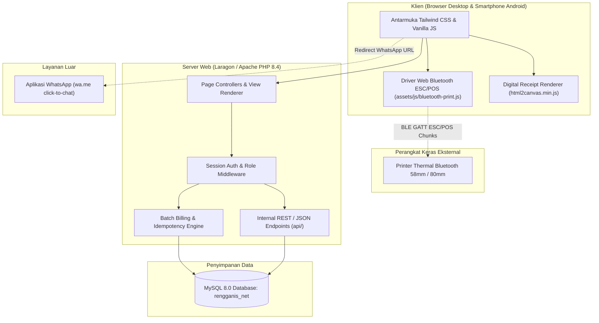

# Architecture: Rengganis Net

## Overview

Rengganis Net dibangun menggunakan arsitektur web Server-Side Rendered (SSR) berbasis PHP 8.4 Native yang terhubung ke database relasional MySQL 8.0 melalui PDO (PHP Data Objects). Antarmuka pengguna dirancang responsif menggunakan Tailwind CSS, ikon FontAwesome 6, dan tipografi modern Google Fonts untuk mendukung penggunaan di layar desktop maupun browser smartphone petugas lapangan. Sistem memanfaatkan Web Bluetooth API untuk mengirimkan perintah cetak ESC/POS secara langsung dari browser ke printer thermal mini Bluetooth (58mm/80mm) tanpa perantara driver OS yang rumit. Seluruh logika pembuatan tagihan bulanan, validasi status pelanggan (aktif/cuti/isolir), serta pencegahan tagihan ganda diproses secara terpusat dan aman pada lingkungan server Laragon / Apache lokal.

## Tech Stack

| Lapisan | Pilihan | Alasan | Alternatif yang ditolak |
|---|---|---|---|
| Frontend/UI | Tailwind CSS, Vanilla JavaScript, FontAwesome 6, Google Fonts | Ringan, responsif untuk smartphone petugas, dan tidak memerlukan bundling berat (pilihan mahasiswa) | - |
| Backend | PHP 8.4 Native dengan PDO MySQL | Eksekusi cepat, mudah dideploy di server lokal ISP, dan memiliki keandalan tinggi (pilihan mahasiswa) | - |
| Database | MySQL 8.0 (database rengganis_net) | Dukungan relasi tabel kuat, foreign key, dan performa query agregasi tagihan optimal (pilihan mahasiswa) | - |
| Auth & Keamanan | Session-based Auth bawaan PHP + Enkripsi Password bcrypt | Aman dari injeksi kredensial, sederhana, dan tidak memerlukan layanan pihak ketiga berbayar (pilihan mahasiswa) | - |
| Hosting & Server | Server On-Premise Mini PC / Laragon Apache / Linux VPS | Cocok untuk server jaringan lokal RT/RW Net yang dapat diakses langsung oleh kasir dan teknisi (pilihan mahasiswa) | - |
| Pengujian (Testing) | Skrip verifikasi otomatis PHP (php tests/test_all_requirements.php) | Menguji 12 butir kriteria penerimaan fungsional secara instan dalam satu perintah CLI (pilihan mahasiswa) | - |
| Ekstra (Thermal Print) | Web Bluetooth API ESC/POS | Mengirim byte ESC/POS langsung dari browser Chrome Android/PC ke printer thermal mini tanpa driver tambahan (pilihan mahasiswa) | - |
| Ekstra (Digital Receipt) | html2canvas | Merender elemen HTML struk pembayaran menjadi gambar PNG resolusi tinggi untuk diunduh atau dibagikan (pilihan mahasiswa) | - |
| Ekstra (Notifikasi WA) | WhatsApp Click-to-Chat (wa.me) | Format pesan terstruktur dengan opsi bayar Online QR dan Offline Tunai tanpa biaya langganan API gateway (pilihan mahasiswa) | - |

Kata kunci stack proyek: `PHP`, `MySQL`, `Tailwind CSS`, `Web Bluetooth ESC/POS`, `Laragon`.

## System Diagram



## Project Structure

```text
rengganis.net/
├── .github/                  # Konfigurasi workflow GitHub Actions CI & template PR
│   └── workflows/ci.yml      # Skrip verifikasi CI otomatis
├── api/                      # Endpoint internal untuk request JSON/AJAX
│   ├── get_customer.php      # Ambil data rincian pelanggan via AJAX
│   └── pay_bill.php          # Proses pelunasan tagihan cepat
├── assets/                   # Aset statis frontend
│   ├── css/                  # Berkas Tailwind CSS dan kustom styling
│   └── js/                   # Skrip Vanilla JS logika interaktif
│       ├── bluetooth-print.js# Driver ESC/POS Web Bluetooth API
│       └── html2canvas.min.js# Pustaka tangkapan struk digital PNG
├── config/                   # Konfigurasi sistem dan basis data
│   └── database.php          # Koneksi PDO MySQL & fungsi helper konfigurasi
├── database/                 # Skrip skema dan data awal basis data
│   └── schema.sql            # Definisi 6 tabel DDL MySQL
├── docs/                     # Paket dokumentasi proyek lengkap
│   ├── PRD.md                # Product Requirements Document
│   ├── ARCHITECTURE.md       # Spesifikasi arsitektur sistem
│   ├── DESIGN_SYSTEM.md      # Panduan token desain & visual
│   ├── SECURITY.md           # Kebijakan keamanan & otorisasi
│   ├── CODE_STYLE.md         # Konvensi gaya penulisan kode
│   ├── TESTING.md            # Rencana dan skrip pengujian
│   ├── EVALS.md              # Evaluasi kelayakan & metrik
│   ├── WORKFLOW.md           # Alur kerja git branch & commit
│   ├── GUARDRAILS.md         # Batasan keselamatan & kode terlarang
│   ├── TASKS.md              # Daftar task pekerjaan bertahap
│   ├── PROGRESS.md           # Pelacak status pengerjaan task
│   ├── DECISIONS.md          # Catatan keputusan arsitektur (ADR)
│   ├── REVIEW.md             # Catatan peninjauan mandiri berkala
│   └── LESSONS.md            # Refleksi dan pelajaran proyek
├── includes/                 # Modul PHP yang dapat digunakan kembali
│   ├── auth.php              # Guard otentikasi sesi & hak akses peran
│   ├── header.php            # Kerangka header HTML & navigasi sidebar
│   ├── footer.php            # Kerangka footer HTML & modal global
│   └── helpers.php           # Fungsi helper billing, format rupiah, dan log status
├── tests/                    # Berkas pengujian otomatis
│   └── test_all_requirements.php # Skrip verifikasi 12 butir kebutuhan FR-01 s/d FR-08
├── bills.php                 # Halaman manajemen tagihan & modal struk
├── customers.php             # Halaman CRUD data pelanggan & kelola cuti
├── index.php                 # Dasbor analitik, ringkasan omzet, & collection rate
├── login.php                 # Halaman autentikasi login multi-role
├── logout.php                # Penutup sesi pengguna
├── packages.php              # Manajemen paket layanan internet WiFi
├── print-report.php          # Halaman pratinjau cetak laporan A4
├── reports.php               # Halaman laporan keuangan & ekspor Excel/CSV
├── settings.php              # Pengaturan profil perusahaan & struk
├── users.php                 # Manajemen pengguna sistem (Admin only)
├── AGENTS.md                 # Instruksi utama untuk agen AI coding
├── README.md                 # Dokumentasi umum repositori
└── SPEC.json                 # Spesifikasi tunggal sumber kebenaran (Single Source of Truth)
```

## Data Model

Database `rengganis_net` terdiri dari 6 tabel relasional MySQL:

### 1. Entitas `users` (Manajemen Akun Pengguna)
| Field | Tipe | Keterangan |
|---|---|---|
| `id` | INT AUTO_INCREMENT (PK) | Pengenal unik pengguna |
| `username` | VARCHAR(50) UNIQUE | Nama login pengguna (data pribadi dasar) |
| `password` | VARCHAR(255) | Hash kata sandi menggunakan enkripsi bcrypt |
| `name` | VARCHAR(100) | Nama lengkap petugas / admin (data pribadi dasar) |
| `role` | ENUM('admin','teknisi','kolektor') | Peran dan batas otorisasi pengguna |
| `created_at` | DATETIME | Waktu pembuatan akun |

### 2. Entitas `packages` (Paket Layanan WiFi)
| Field | Tipe | Keterangan |
|---|---|---|
| `id` | INT AUTO_INCREMENT (PK) | Pengenal unik paket |
| `name` | VARCHAR(50) | Nama paket (misal: Paket Rumahan 10 Mbps) |
| `speed` | VARCHAR(20) | Kecepatan bandwidth (misal: 10 Mbps) |
| `price` | DECIMAL(10,2) | Tarif langganan per bulan dalam satuan rupiah |
| `description` | TEXT | Keterangan fasilitas paket |
| `is_active` | TINYINT(1) | Status ketersediaan paket (1=aktif, 0=nonaktif) |

### 3. Entitas `customers` (Data Pelanggan)
| Field | Tipe | Keterangan |
|---|---|---|
| `id` | INT AUTO_INCREMENT (PK) | Pengenal unik pelanggan |
| `customer_code` | VARCHAR(20) UNIQUE | Kode pelanggan (misal: CUST-001) |
| `name` | VARCHAR(100) | Nama pelanggan (data pribadi lokasi/kontak) |
| `phone` | VARCHAR(20) | Nomor telepon / WhatsApp (data kontak) |
| `address` | TEXT | Alamat pemasangan (data lokasi) |
| `package_id` | INT (FK -> packages.id) | Paket internet yang digunakan |
| `ip_address` | VARCHAR(45) | Alokasi IP Address statis / PPPoE |
| `installation_date` | DATE | Tanggal awal pemasangan WiFi |
| `status` | ENUM('aktif','cuti','isolir') | Status langganan saat ini |
| `notes` | TEXT | Catatan teknis lapangan |

### 4. Entitas `bills` (Tagihan Bulanan)
| Field | Tipe | Keterangan |
|---|---|---|
| `id` | INT AUTO_INCREMENT (PK) | Pengenal unik tagihan |
| `bill_number` | VARCHAR(50) UNIQUE | Nomor tagihan resmi (misal: INV/202610/0001) |
| `customer_id` | INT (FK -> customers.id) | Relasi ke pelanggan |
| `period_month` | TINYINT | Bulan periode penagihan (1–12) |
| `period_year` | SMALLINT | Tahun periode penagihan (misal: 2026) |
| `amount` | DECIMAL(10,2) | Nominal tagihan |
| `status` | ENUM('belum_lunas','lunas') | Status pelunasan tagihan |
| `payment_method` | VARCHAR(30) | Metode pembayaran (Tunai, Transfer, QRIS, DANA) |
| `payment_date` | DATETIME | Waktu pelunasan dicatat |
| `collector_name` | VARCHAR(100) | Nama petugas yang menerima pembayaran |
| `notes` | TEXT | Keterangan tambahan pelunasan |

*Unique Constraint:* Terdapat indeks unik pada `(customer_id, period_month, period_year)` untuk mencegah tagihan ganda.

### 5. Entitas `status_logs` (Riwayat Perubahan Status)
| Field | Tipe | Keterangan |
|---|---|---|
| `id` | INT AUTO_INCREMENT (PK) | Pengenal unik catatan audit |
| `customer_id` | INT (FK -> customers.id) | Relasi ke pelanggan |
| `old_status` | VARCHAR(20) | Status sebelum perubahan |
| `new_status` | VARCHAR(20) | Status setelah perubahan |
| `reason` | TEXT | Alasan perubahan status (misal: cuti kerja ke luar kota) |
| `changed_by` | VARCHAR(50) | Username staf yang melakukan perubahan |
| `created_at` | DATETIME | Waktu pencatatan perubahan status |

### 6. Entitas `settings` (Konfigurasi Profil & Struk)
| Field | Tipe | Keterangan |
|---|---|---|
| `id` | INT AUTO_INCREMENT (PK) | Pengenal unik setelan |
| `setting_key` | VARCHAR(50) UNIQUE | Kunci konfigurasi (misal: company_name, receipt_footer) |
| `setting_value` | TEXT | Nilai konfigurasi sistem |

## Data Flow

1. **Alur Batch Billing Otomatis (F3):** Admin membuka halaman `bills.php` dan memicu pembuatan tagihan periode bulan `M` tahun `Y`. Backend menjalankan fungsi `generateMonthlyBills()` di `includes/helpers.php`. Sistem mengecek tabel `customers` dengan kriteria `status = 'aktif'`. Pelanggan berstatus `cuti` atau `isolir` otomatis dilewati. Untuk setiap pelanggan aktif, fungsi memeriksa apakah tagihan pada periode tersebut sudah ada. Jika belum ada, sistem menyisipkan baris baru ke tabel `bills` dengan nominal sesuai tarif paket di tabel `packages`.
2. **Alur Pelunasan dan Cetak Struk Bluetooth (F5):** Kasir menekan tombol pelunasan pada `bills.php`. Permintaan dikirim dengan token CSRF. Server memverifikasi sesi kasir/admin, memperbarui status tagihan menjadi `lunas`, mengisi `payment_date = NOW()`, serta mencatat metode bayar dan nama kasir. Server merespons dengan data JSON tagihan yang lunas. Klien Vanilla JS menerima data tersebut dan menampilkan modal struk. Jika kasir menekan tombol "Cetak Struk Bluetooth", skrip `assets/js/bluetooth-print.js` menginisialisasi Web Bluetooth API (GATT Service ESC/POS) dan mentransmisikan buffer byte perintah pemotong dan teks tebal secara bertahap (chunking 512 byte) ke printer thermal mini.
3. **Alur Notifikasi WhatsApp (F4):** Kasir atau admin menekan tombol ikon WhatsApp pada daftar tagihan. Skrip klien merakit teks pesan terformat yang mencantumkan nama pelanggan, nomor tagihan, total rupiah, tautan pembayaran online via QR, serta instruksi bayar offline tunai pas. Tautan `https://wa.me/{nomor_pelanggan}?text={pesan_encoded}` dibuka langsung di peramban atau dialihkan ke aplikasi WhatsApp mobile.

## External Services

| Layanan | Fungsi | Data yang dikirim | Batas/biaya gratis | Rencana cadangan bila gagal |
|---|---|---|---|---|
| Web Bluetooth API (Perangkat Keras Lokal) | Koneksi nirkabel ke printer thermal mini 58mm/80mm | Byte ESC/POS teks struk transaksi | Gratis bawaan peramban Chrome / Edge Android & PC | Fallback ke dialog cetak standar browser (`@media print` 58mm) atau unduh gambar PNG struk digital |
| WhatsApp Click-to-Chat (`wa.me`) | Pengiriman pesan notifikasi tagihan dan kuitansi pelunasan | Nomor WhatsApp pelanggan dan teks rincian tagihan | Gratis tanpa kuota API resmi | Teks pesan dapat disalin secara manual ke papan klip (clipboard) |
| Google Fonts CDN | Memuat tipografi Plus Jakarta Sans dan JetBrains Mono | Tidak ada data pengguna; hanya unduhan berkas font CSS | Gratis tanpa batas | Fallback font keluarga sistem sans-serif dan monospace lokal |
| FontAwesome 6 CDN | Menampilkan ikon visual antarmuka | Berkas SVG/font ikon | Gratis (FontAwesome Free CDN) | Fallback teks label alternatif |

## Environments and Configuration

Sistem beroperasi pada tiga tingkatan lingkungan:
1. **Lokal (Development):** Berjalan di Laragon atau server bawaan PHP (`php -S 127.0.0.1:8080`), terkoneksi ke MySQL lokal port 3306.
2. **Staging / Pengujian:** Menjalankan skrip verifikasi otomatis `php tests/test_all_requirements.php` di GitHub Actions CI untuk memvalidasi seluruh fungsional sebelum rilis.
3. **Produksi (On-Premise / Cloud VPS):** Berjalan di server Apache/Nginx dengan PHP 8.4 dan MariaDB/MySQL terisolasi di jaringan lokal atau VPS Linux.

Daftar variabel lingkungan yang dibutuhkan:
- `DB_HOST`: Host basis data MySQL (contoh: `localhost` atau `127.0.0.1`)
- `DB_NAME`: Nama basis data (contoh: `rengganis_net`)
- `DB_USER`: Nama pengguna basis data (contoh: `root`)
- `DB_PASS`: Kata sandi basis data (rahasia)
- `APP_ENV`: Mode aplikasi (`development` atau `production`)
- `APP_URL`: URL utama akses aplikasi (contoh: `http://localhost/rengganis.net`)

Kredensial rahasia disimpan di konfigurasi lokal `config/database.php` atau `.env` lokal dan dilarang keras di-commit ke repositori publik Git. Contoh struktur disediakan di `.env.example`.

## Deployment

1. **Lokal Laragon On-Premise:** Repositori di-clone ke direktori root web server Laragon (`C:\laragon\www\rengganis.net`). Database diimpor melalui `database/schema.sql`. Akses dibuka via browser di `http://localhost/rengganis.net`.
2. **Continuous Integration (GitHub Actions):** Setiap push atau pull request ke branch `main` memicu alur kerja CI `.github/workflows/ci.yml`. Runner menyiapkan lingkungan PHP 8.4, memvalidasi sintaks kode (`php -l`), menyiapkan database pengujian, dan menjalankan skrip `php tests/test_all_requirements.php`.
3. **Pemeriksaan Kesehatan (Health Check):** Pemeriksaan dilakukan dengan mengeksekusi skrip `tests/test_all_requirements.php` yang memverifikasi koneksi database, ketersediaan 6 tabel, hash bcrypt akun default, dan validitas batch billing.
4. **Rollback:** Jika pembaruan kode mengalami anomali, administrator cukup melakukan checkout commit Git sebelumnya (`git checkout <commit_hash>`) dan memastikan skema database tetap sinkron.

## Platform Notes

Catatan khusus platform Web:
1. **Rendering:** Sistem menggunakan server-side rendering murni PHP yang menghasilkan HTML siap saji dengan waktu muat sangat cepat tanpa overhead kompilasi SPA.
2. **Web Bluetooth API:** Fitur cetak Bluetooth ESC/POS membutuhkan peramban berbasis Chromium (Google Chrome atau Microsoft Edge) pada perangkat Android atau PC dengan Bluetooth aktif serta izin lokasi aktif (khusus Android).
3. **Koneksi HTTP / HTTPS:** Web Bluetooth API di Chrome Android mewajibkan akses melalui protokol aman `https://` atau pengecualian khusus untuk alamat lokal `localhost` / `127.0.0.1`.
4. **Responsivitas Layar Ponsel:** Tabel data dan form modal dioptimalkan untuk navigasi sentuh satu tangan pada smartphone Android resolusi layar 360px ke atas.
5. **Cetak Thermal Fallback:** Layout CSS `@media print` dikonfigurasi khusus dengan lebar tetap 58mm dan 80mm agar struk fisik tetap rapi jika dicetak via dialog bawaan Android.

## Constraints and Trade-offs

1. **Waktu dan Ukuran Tim:** Proyek dikerjakan secara mandiri oleh 1 orang mahasiswa dalam durasi 4 minggu, sehingga fokus dicurahkan pada penyempurnaan keandalan fitur penagihan inti dan stabilitas cetak struk (lihat [PRD](file:///d:/laragon/www/rengganis.net/docs/PRD.md)).
2. **Arsitektur SSR PHP Native vs SPA Terpisah (ADR-002, ADR-003):** Diputuskan menggunakan SSR PHP modular tanpa framework frontend terpisah guna menjaga performa tetap sangat ringan di hardware mini PC server lokal RT/RW Net.
3. **Penyimpanan Password bcrypt dan Sesi PHP (ADR-004):** Tidak menggunakan token JWT atau layanan auth eksternal cloud agar aplikasi sepenuhnya dapat beroperasi mandiri secara offline di jaringan lokal.
4. **Deploy On-Premise Laragon / VPS (ADR-005):** Server ditempatkan pada infrastruktur lokal pengelola ISP untuk menghemat biaya operasional cloud bulanan.
5. **Level Proses Dasar dan Pengujian Otomatis Mandiri (ADR-006):** Alur verifikasi disederhanakan dengan skrip pengujian terpadu `test_all_requirements.php` yang dapat dieksekusi sekali jalan tanpa ketergantungan paket pengujian berat.
